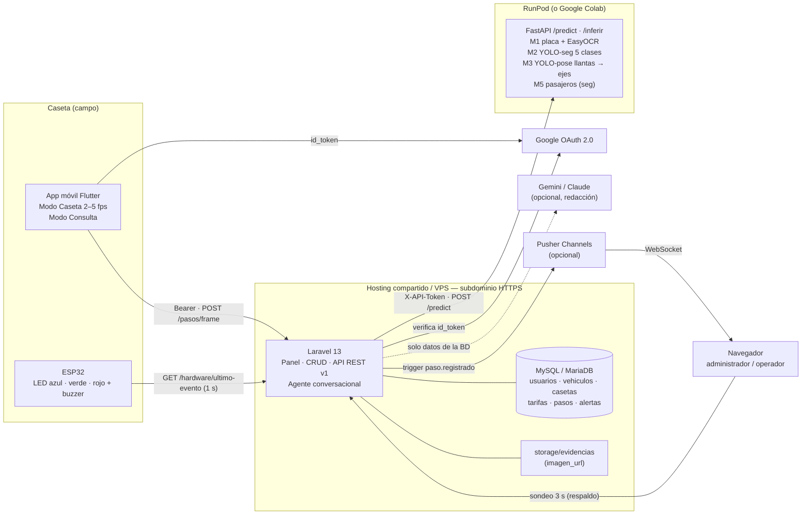
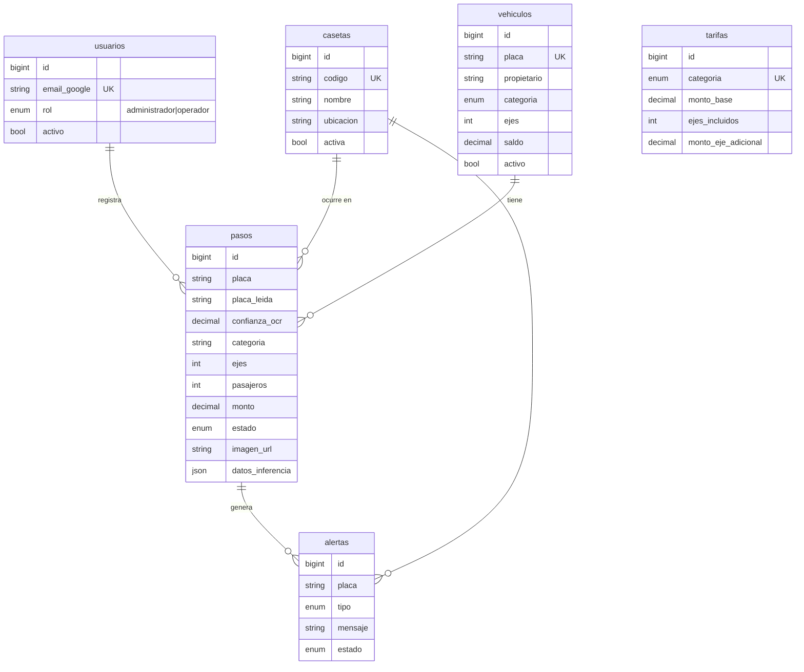

# Arquitectura

## Principio "nada en local"

| Componente | Dónde corre | Cómo se configura |
|---|---|---|
| Web + API + BD | Subdominio HTTPS (cPanel/VPS) | `.env` del servidor |
| Inferencia | Pod de RunPod (o Colab) | `INFERENCE_URL` + `INFERENCE_TOKEN` (en `.env` o en **Estado → Configurar inferencia**) |
| App móvil | Teléfono | `--dart-define=API_BASE_URL=https://...` o pestaña **Ajustes** |
| Hardware | ESP32 en la caseta | Consulta la URL pública (no requiere IP pública ni túneles) |

La PC solo se usa para programar, compilar el APK y subir el repositorio. Ningún componente usa `localhost`
ni IPs privadas en producción.

## Flujo de un paso

1. La app (Modo Caseta) toma un frame cada 200–500 ms y lo envía a `POST /api/v1/pasos/frame` con el token.
2. Laravel reenvía el JPEG a `INFERENCE_URL/predict` (cabecera `X-API-Token`).
3. El servidor de inferencia devuelve `placa`, `placa_normalizada`, `confianza_ocr`, `categoria`, `ejes`, `pasajeros`, `latencia_ms`.
4. Laravel normaliza la placa (formato boliviano + correcciones O↔0, I↔1, B↔8, S↔5) y:
   - descarta frames sin vehículo o con placa ilegible / confianza < `PEAJE_CONFIANZA_MINIMA_OCR`;
   - descarta duplicados (misma placa y caseta en `PEAJE_VENTANA_DUPLICADOS` s);
   - calcula la tarifa `base + (ejes − ejes_incluidos) × monto_eje_adicional`;
   - si está registrada, activa y con saldo → descuenta el saldo y guarda el paso `cobrado`;
   - si no → guarda el paso `alerta` y crea la alerta (`no_registrada`, `saldo_insuficiente`, `vehiculo_inactivo`).
5. Guarda la imagen de evidencia (`pasos.imagen_url`) y los pasajeros (`pasos.pasajeros`).
6. Publica `paso.registrado` / `alerta.creada` en Pusher → el panel se actualiza sin recargar (sin Pusher, el panel sondea cada 3 s).
7. El ESP32 lee `GET /api/v1/hardware/ultimo-evento`: azul mientras se infiere, luego verde (+1 beep) o rojo (+3 beeps).
8. La app muestra placa, categoría, ejes, pasajeros, tarifa y estado.

## Modelo de datos

## Seguridad

- Login **solo con Google** (Socialite en la web, `id_token` verificado con Google en la API). Sin contraseñas propias.
- Lista blanca `usuarios.email_google` + `usuarios.activo`; el docente `doc.alvaro.pinto.ma@unifranz.edu.bo` se crea como administrador en la semilla.
- Roles: `administrador` (vehículos, tarifas, casetas, lista blanca, inferencia) y `operador` (registra pasos y consulta placas).
- Toda la API exige token Bearer salvo `POST /api/v1/auth/google`; el ESP32 usa un token de dispositivo de solo lectura.
- Secretos solo en `.env` (nunca en el repositorio); `.env.example` documenta cada variable.
- Pasajeros: solo conteo y cajas; no hay reconocimiento facial ni se guardan recortes de rostros.

## Agente conversacional

El código (no el LLM) decide la intención y consulta la BD; el resultado es siempre uno de los 4 estados
(`Registrada y con paso`, `Registrada sin paso`, `Identificada no registrada`, `No existe`). Si se configura
`GEMINI_API_KEY` (o `AGENTE_PROVEEDOR=anthropic` + `ANTHROPIC_API_KEY`), el LLM solo **redacta** la respuesta con
esos datos (una llamada, sin herramientas); si no hay clave o falla, se usa una plantilla determinista
(`fuente: plantilla`). Ningún dato sale del modelo de lenguaje.
